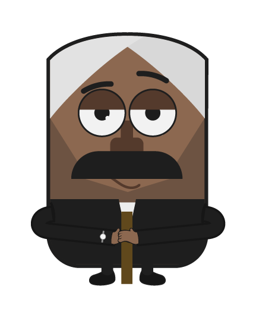
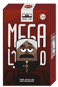
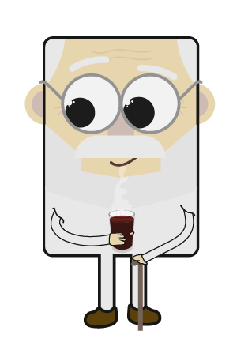
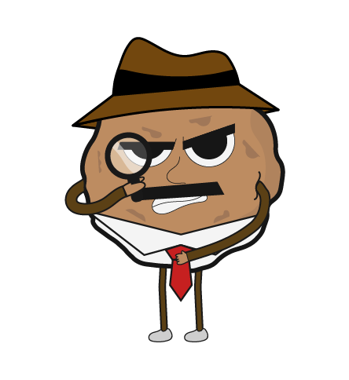
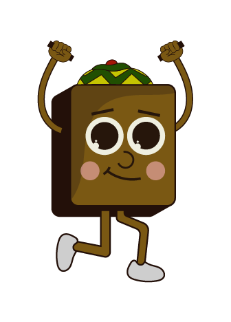
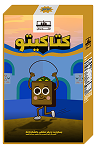
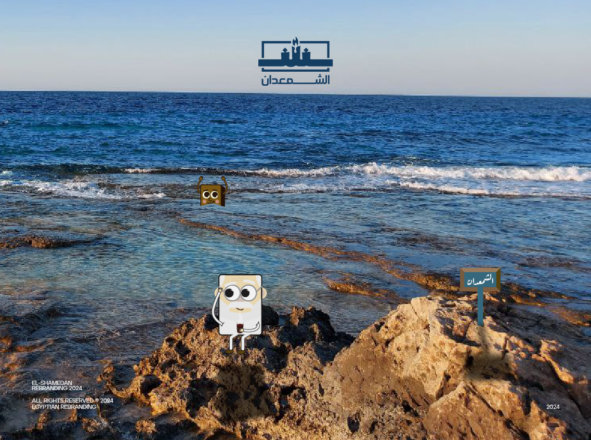

# 🍫 تطبيق الشمعدان | El-Shamedan Snack Brand App

<div align="center">
  
  <br /><br />
  <p align="center">
    <strong>تطبيق موبايل تفاعلي باللغة العربية (RTL) مبني بإطار عمل Flutter</strong><br />
    يقدم تجربة غامرة لعلامة الشمعدان العريقة وشخصياتها الكرتونية الشهيرة، مع قصص مصورة، خط زمني لمراحل التصنيع، وألعاب ومسابقات تفاعلية.
  </p>
  
</div>

---

## 📌 جدول المحتويات
- [نظرة عامة على المشروع](#-نظرة-عامة-على-المشروع)
- [عائلة شخصيات الشمعدان](#-عائلة-شخصيات-الشمعدان)
- [لوحة الألوان المعتمدة (Color Palette)](#-لوحة-الألوان-المعتمدة-color-palette)
- [أقسام شاشة المنتج المخصصة](#-أقسام-شاشة-المنتج-المخصصة)
- [المكونات المشتركة (Shared Widgets)](#-المكونات-المشتركة-shared-widgets)
- [الهيكل البرمجي للمشروع (Project Architecture)](#-الهيكل-البرمجي-للمشروع-project-architecture)
- [الخطوط والتقنيات المستخدمة](#-الخطوط-والتقنيات-المستخدمة)
- [طريقة التثبيت والتشغيل](#-طريقة-التثبيت-والتشغيل)

---

## 🌟 نظرة عامة على المشروع
تطبيق **الشمعدان** هو واجهة رقمية عصرية تعيد إحياء ذكريات ومحبة منتجات الشمعدان التاريخية في مصر والعالم العربي. يركز التطبيق على تقديم تجربة مستخدم فريدة من خلال:
- **دعم كامل لاتجاه اليمين لليسار (RTL)** مع محاذاة دقيقة ومراعاة القواعد الهندسية للشاشات العربية.
- **تخصيص كامل لكل شخصية**: كل شخصية تمتلك شاشة مستقلة بهويتها البصرية الخاصة، ألوانها، مكوناتها، وخط إنتاجها.
- **خلفية بيانات Mock JSON**: تحميل تفاصيل الشخصيات والمنتجات بسلاسة ودون الحاجة لاتصال خارجي عبر `assets/mock_backend/items.json`.
- **أزرار موحدة وتصميم متناسق**: استخدام زر المشروع المعتمد `PrimaryButton` في الأقسام التفاعلية.

---

## 👥 عائلة شخصيات الشمعدان

<table align="center" width="100%">
  <tr>
    <td align="center" width="25%">
      <br />
      <strong>عمدة</strong><br />
      <br />
      <em>ملك الشوكولاتة والكراميل</em>
    </td>
    <td align="center" width="25%">
      <br />
      <strong>بسكاوي</strong><br />
      <br />
      <em>خبير القرمشة ومزاج الشاي</em>
    </td>
    <td align="center" width="25%">
      <br />
      <strong>مستر كوكيز</strong><br />
      <br />
      <em>المحقق الذكي وسر الخلطة</em>
    </td>
    <td align="center" width="25%">
      <br />
      <strong>كتاكيتو</strong><br />
      <br />
      <em>الويفر الهش خفيف الظل</em>
    </td>
  </tr>
</table>

### تفاصيل الشخصيات:
1. **عمدة (Omda - ID: 1)**
   - **الوصف**: عمدة ده الكل في الكل هنا وكلمته بتمشي على الكل بس طيب وطعمه هيعجبك.
   - **الرسالة**: *"محتاج حد تقيل ؟ كلم عمدة"*
   - **المنتج**: ويفر عمدة بالشوكولاتة الفاخرة وحشوة الكراميل.

2. **بسكاوي (Beskawy - ID: 2)**
   - **الوصف**: ده أكبر واحد فينا وليه احترامه، كفاية إنه بيعرف يظبط الشاي ويفهم سر القرمشة الأصلية.
   - **الرسالة**: *"بسكويت يروق البال"*
   - **المنتج**: بسكويت الشوفان المقرمش السادة وبالتمر.

3. **مستر كوكيز (Cookies - ID: 3)**
   - **الوصف**: خلي بالك من كوكيز، هو يبان كوكي عادي بس محقق ذكي وسره خطير في وصفتنا السرية.
   - **الرسالة**: *"طري من الداخل ومقرمش من الخارج"*
   - **المنتج**: كوكيز بقطع الشوكولاتة البلجيكية الذائبة.

4. **كتاكيتو (Kitkito - ID: 4)**
   - **الوصف**: أطيب واحد فينا وقلبه أبيض وهش من جوه، بيفرح أي حد ويحلي أي لحظة بابتسامته.
   - **الرسالة**: *"سر الخفة والقرمشة الذهبية"*
   - **المنتج**: ويفر كتاكيتو بالفانيليا والشوكولاتة اللذيذة.

---

## 🎨 لوحة الألوان المعتمدة (Color Palette)

تمت معايرة ألوان التطبيق بدقة لتعكس هوية كل منتج:

| الشخصية | اللون الأساسي (Light / Accent) | اللون الداكن (Heavy / Wave) | كود الهيكس في الكود |
| :--- | :--- | :--- | :--- |
| **كتاكيتو (Kitkito)** | Primary / Light: `#DCB412` | Primary / Heavy: `#B0931E` | `AppColor.primarylight` / `AppColor.primaryHeavy` |
| **بسكاوي (Beskawy)** | Accent / Teal: `#88ABA6` | Accent / Heavy: `#489186` | `AppColor.accentTale` / `AppColor.accentHeavy` |
| **كوكيز (Cookies)** | Background / Black: `#2D1B14` | Background / Heavy: `#27160F` | `AppColor.backgroundBlack` / `AppColor.backgroundBlackHeavy` |
| **عمدة (Omda)** | Secondary / Light: `#A42B20` | Secondary / Heavy: `#891811` | `AppColor.secondarylight` / `AppColor.secondaryHeavy` |
| **الخلفية العامة** | Off-White: `#F9F7F2` | White: `#FFFFFF` | `AppColor.backGroundColor` / `AppColor.white` |

---

## 📱 أقسام شاشة المنتج المخصصة

كل شاشة منتج في التطبيق مقسمة إلى مكونات مستقلة وقابلة لإعادة الاستخدام:

```
┌─────────────────────────────────────────────────────────────┐
│ 1. ترويسة البطل (ItemHeroSection)                            │
│    - عنوان المنتج وعنوانه الفرعي                             │
│    - صورة العبوة المخصصة بحجم متناسق                        │
├─────────────────────────────────────────────────────────────┤
│ 2. الحروف الزخرفية (DecorativeLettersSection)                │
│    - حروف الاسم متباعدة بتدوير وحركات رأسية جمالية           │
├─────────────────────────────────────────────────────────────┤
│ 3. قصة البطل والمكونات العائمة (CharacterStorySection)       │
│    - شكل عضوي ملون (CustomPaint Blob) يتوسطه البطل          │
│    - عناصر طافية (كاكاو، حليب، قمح، شوكولاتة، ويفر)         │
│    - نص القصة المميز للشخصية                                │
├─────────────────────────────────────────────────────────────┤
│ 4. تايم لاين خطوات الصنع (TimelineSection)                  │
│    - مسار رأسي أبيض متصل مع نقاط ارتكاز دائرية               │
│    - عناوين المراحل على اليمين وأيقونات توضيحية على اليسار  │
│    - خلفية منحنية انسيابية باللون الداكن (Heavy Color)       │
├─────────────────────────────────────────────────────────────┤
│ 5. القسم التفاعلي (InteractiveSection)                      │
│    - مسكوت توضيحي وفقاعة حوار ("توقع نكهة عمدة المفضلة!")   │
│    - خيارات المسابقة وألعاب الذاكرة                         │
│    - استخدام أزرار PrimaryButton المعتمدة                   │
├─────────────────────────────────────────────────────────────┤
│ 6. الفوتر المنحني ومحدد الشخصيات (ItemFooterSection)        │
│    - قبة بيضاء علوية بانحناء 64px                           │
│    - أزرار سريعة ("تاريخنا"، "اختار فريقك")                 │
│    - شبكة اختيار سريعة للتبديل الفوري بين الأبطال الأربعة   │
│    - أيقونات التواصل الاجتماعي وحقوق الملكية                │
└─────────────────────────────────────────────────────────────┘
```

---

## 🔘 المكونات المشتركة (Shared Widgets)

### 1. زر المشروع الأساسي (`PrimaryButton`)
المكون المعتمد للأزرار في التطبيق بتصميم نقي وجذاب:
- زوايا دائرية بحجم `8.0`.
- خلفية بيضاء مع حدود داكنة ناعمة.
- يدعم حالة التحديد (`isSelected`) مع أيقونة تحقق ولمسة لون ذهبية.
- حجم مدمج ومريح للّمس والمشاهدة.

### 2. الشريط العلوي (`CustomAppBar`)
شريط علوي شفاف يحتوي على شعار الشمعدان بدقة عالية ويتناسق مع جميع الخلفيات.

### 3. بطاقة الشخصية (`CharacterCard`)
بطاقة تفاعلية في الصفحة الرئيسية مع تأثير ظلال متدرج وتصميم نصفين يبرز شخصية الشمعدان مع نبذة مشوقة للانتقال لشاشة البطل.

---

## 🏗 الهيكل البرمجي للمشروع (Project Architecture)

```
shamedan/
├── assets/
│   ├── images/                 # صور الأبطال، عبوات المنتجات، والأيقونات
│   └── mock_backend/
│       └── items.json          # قاعدة بيانات المنتجات والشخصيات والألوان
├── lib/
│   ├── main.dart               # نقطة الانطلاق الرئيسية للتطبيق
│   ├── core/
│   │   ├── utils/
│   │   │   ├── app_color.dart  # ثوابت الألوان المعتمدة لكل بطل
│   │   │   └── Appfonts.dart   # أنماط الخطوط العربية (Google Fonts)
│   │   └── widgets/
│   │       ├── character_card.dart  # بطاقة عرض الشخصيات في الرئيسية
│   │       ├── customAppBar.dart    # شريط التطبيق العلوي بالشعار
│   │       └── primarybutton.dart   # زر المشروع الموحد
│   └── Features/
│       ├── home/               # الشاشة الرئيسية
│       │   ├── presentation/
│       │   │   └── home_screen.dart
│       │   └── widgets/        # أقسام الرئيسية الخمسة
│       └── item/               # شاشة المنتج المخصصة
│           ├── data/
│           │   ├── item_model.dart       # نماذج البيانات
│           │   └── item_repository.dart  # مستودع قراءة items.json
│           └── presentation/
│               ├── itemscreen.dart       # منسق شاشة البطل
│               └── widgets/              # الأقسام الستة لشاشة المنتج:
│                   ├── hero_section.dart
│                   ├── decorative_letters_section.dart
│                   ├── character_story_section.dart
│                   ├── timeline_section.dart
│                   ├── interactive_section.dart
│                   └── item_footer_section.dart
└── pubspec.yaml                # إعدادات الحزم والخطوط وملفات الميديا
```

---

## 🔤 الخطوط والتقنيات المستخدمة

- **Flutter SDK**: Dart ^3.12.2
- **Google Fonts** (`google_fonts: ^8.1.0`):
  - **Lalezar**: للعناوين الكبيرة البارزة وأسماء الشخصيات.
  - **Lemonada**: لعناوين الخطوات والأقسام الفرعية التعبيرية.
  - **Cairo**: للنصوص التوضيحية ومحتوى الأزرار لسهولة القراءة.
  - **Aref Ruqaa**: للمسات التراثية والتاريخية.
- **RTL Directionality**: دعم افتراضي لكامل الشاشات مع `PositionedDirectional` و `start`/`end`.

---

## 🚀 طريقة التثبيت والتشغيل

1. **استنساخ المستودع (Clone the repo)**:
   ```bash
   git clone https://github.com/MohamedEssam2127/shamedan.git
   cd shamedan
   ```

2. **تثبيت الحزم والمكتبات (Get dependencies)**:
   ```bash
   flutter pub get
   ```

3. **تشغيل التطبيق على المحاكي أو الهاتف**:
   ```bash
   flutter run
   ```

---

<div align="center">
  <p>جميع الحقوق محفوظة لشركة <strong>الشمعدان</strong> © 2026</p>
  
</div>
